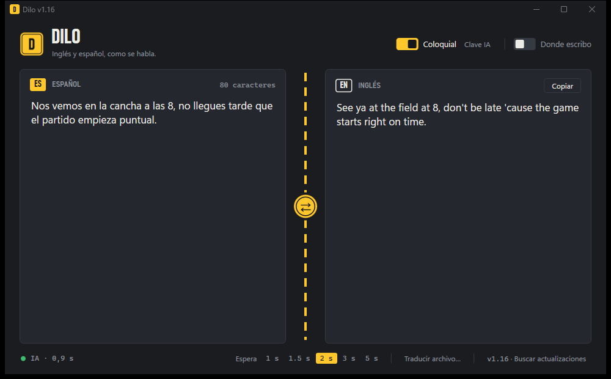

<div align="center">


# Dilo

**English ⇄ Spanish translation for Windows that sounds like people actually talk.**

[](https://github.com/Grawkles/Dilo-releases/releases/latest)
[](https://github.com/Grawkles/Dilo-releases/releases)
[-FFC72C?labelColor=1A1C20)](#system-requirements)

[**Download the latest version**](https://github.com/Grawkles/Dilo-releases/releases/latest) · [Changelog](CHANGELOG.md) · [Report a problem](https://github.com/Grawkles/Dilo-releases/issues/new)



</div>

## Overview

Dilo translates between English and Spanish as you type. It detects which language you
are writing in, switches direction on its own, and can translate in a casual, natural
register instead of textbook phrasing. It also works inside other apps: write in Discord,
WhatsApp Web or Word, and Dilo offers the translation in a small window next to your text.

This repository hosts the official installers and release notes. The source code is
maintained privately.

## Features

- **Live translation.** Results appear while you type; no button to press.
- **Automatic direction.** Write in either language and Dilo detects it.
- **Casual mode.** Optional AI translation that keeps slang and chat abbreviations natural
  (requires a free [Groq](https://console.groq.com) API key).
- **Translate where you type.** A floating card shows the translation of what you write in
  any app, and **Replace what I wrote** swaps your sentence for the translation in place.
- **Selection shortcut.** Select text in any app and press <kbd>Ctrl</kbd>+<kbd>Shift</kbd>+<kbd>T</kbd>.
- **Documents.** Translate `.txt`, `.md`, `.docx` and `.srt` files while keeping their structure.
- **In-app updates.** Dilo checks this repository and updates itself in one click.

## System requirements

| | |
|---|---|
| Operating system | Windows 10 or Windows 11, 64-bit |
| Runtime | None. Everything Dilo needs is included in the installer |
| Disk space | About 80 MB |
| Network | Internet connection for translation |

## Installation

1. Download `Dilo-Setup-<version>.msi` from the [latest release](https://github.com/Grawkles/Dilo-releases/releases/latest).
2. Run the installer and follow the wizard. Dilo is added to the Start menu and the desktop.
3. If Windows shows **"Windows protected your PC"**, select **More info → Run anyway**.
   The installer is not code-signed yet, so Microsoft SmartScreen does not recognize it.
   You can [verify the download](#verifying-your-download) before running it.

### Verifying your download

Every release lists the SHA-256 checksum of its installer, and GitHub shows the same value
next to each file. To check the file you downloaded, open PowerShell in your Downloads folder
and run:

```powershell
Get-FileHash .\Dilo-Setup-1.16.0.msi -Algorithm SHA256
```

The `Hash` value must match the one published in the release. If it does not, delete the
file and download it again.

## Updating

From version 1.16.0, Dilo updates itself:

1. Dilo checks for new versions when it starts. You can also select
   **Buscar actualizaciones** (Check for updates) in the bottom-right corner.
2. When a new version is available, select **Actualizar a vX.Y.Z** (Update to vX.Y.Z).
3. Dilo downloads the installer, verifies its checksum, closes, installs the update and
   reopens. Windows asks for permission once.

Your settings and API key are kept across updates. Versions earlier than 1.16.0 must be
updated once by downloading the installer manually.

## Uninstalling

Open **Settings → Apps → Installed apps**, find **Dilo** and select **Uninstall**.
Your settings stay in `%AppData%\TraductorENES`; delete that folder to remove them too.

## Privacy

- **What leaves your PC:** only the text being translated, sent over HTTPS to the
  translation service in use: Google Translate, Groq (casual mode, with your own key) or
  MyMemory (fallback).
- **What stays on your PC:** your settings and API key, stored in
  `%AppData%\TraductorENES\settings.json`.
- **Translate where you type** is off by default. When enabled, Dilo reads the keys you
  type in other apps to build the current sentence. That sentence is held in memory only
  long enough to translate it and is never written to disk.
- Dilo has no accounts, no analytics and no advertising.

## Troubleshooting

| Problem | Solution |
|---|---|
| "Windows protected your PC" when installing | Select **More info → Run anyway**. See [Installation](#installation). |
| Translations stop working | Check your internet connection. If Google is unavailable, Dilo falls back to AI (with a key) or MyMemory automatically. |
| Casual mode has no effect | Add your free Groq API key with **Clave IA** (AI key). |
| <kbd>Ctrl</kbd>+<kbd>Shift</kbd>+<kbd>T</kbd> does nothing | Another app may already use that shortcut. Close it and restart Dilo. |

## Support

Found a bug or have a suggestion? [Open an issue](https://github.com/Grawkles/Dilo-releases/issues/new)
and include your Dilo version (shown in the bottom-right corner of the window) and your
Windows version. For security issues, see [SECURITY.md](SECURITY.md).

## License

Dilo is free to use. It is provided "as is", without warranty of any kind.
© 2026 Grawkles. All rights reserved.
